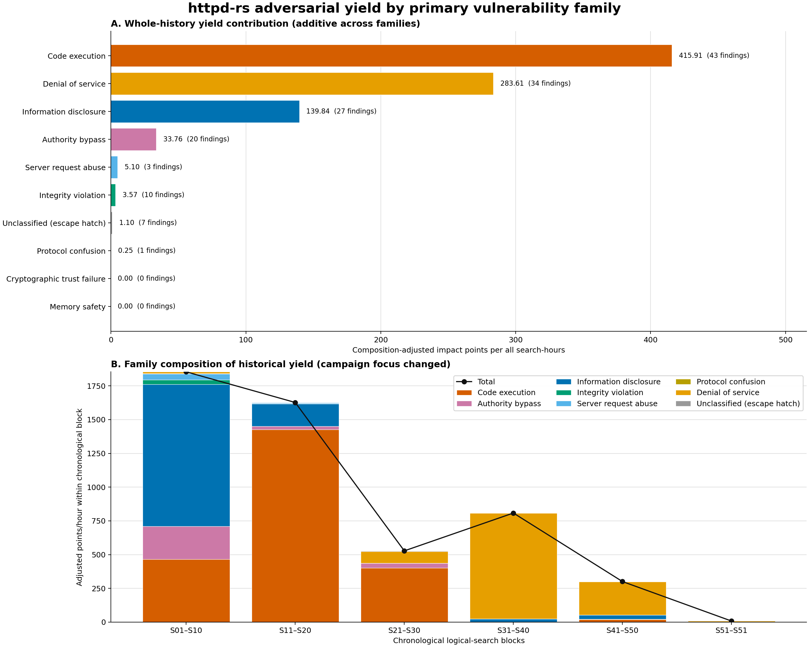

# Adversarial yield by vulnerability family



[Scalable SVG version](yield-by-family.svg)

> Family yield here is an additive decomposition of the whole-history
> score. Each family's adjusted finding points are divided by all recorded
> logical-search hours. It measures contribution to observed historical
> yield, not family-specific search efficiency or vulnerabilities remaining.

Only unique confirmed findings enter the numerator. Impact weights and the
composition discount are defined in
[`../vulnerability-families.md`](../vulnerability-families.md).
`unclassified` is shown for completeness but is an escape hatch rather than
one of the nine tracked vulnerability families.

## Whole-history contribution

The index contains 145 confirmed findings and 17,332.0 adjusted points over 19.626 search-hours, for 883.12 adjusted points/hour.

| Primary family | Confirmed | Findings/all h | Raw points | Adjusted points | Share | Adjusted points/all h |
|---|---:|---:|---:|---:|---:|---:|
| `code_execution` | 43 | 2.19 | 36,700.0 | 8,162.5 | 47.1% | **415.91** |
| `denial_of_service` | 34 | 1.73 | 10,681.0 | 5,566.0 | 32.1% | **283.61** |
| `information_disclosure` | 27 | 1.38 | 9,513.0 | 2,744.5 | 15.8% | **139.84** |
| `authority_bypass` | 20 | 1.02 | 1,640.0 | 662.5 | 3.8% | **33.76** |
| `server_request_abuse` | 3 | 0.15 | 300.0 | 100.0 | 0.6% | **5.10** |
| `integrity_violation` | 10 | 0.51 | 190.0 | 70.0 | 0.4% | **3.57** |
| `unclassified` | 7 | 0.36 | 43.0 | 21.5 | 0.1% | **1.10** |
| `protocol_confusion` | 1 | 0.05 | 10.0 | 5.0 | 0.0% | **0.25** |
| `cryptographic_trust_failure` | 0 | 0.00 | 0.0 | 0.0 | 0.0% | **0.00** |
| `memory_safety` | 0 | 0.00 | 0.0 | 0.0 | 0.0% | **0.00** |

## Severity distribution

| Primary family | Catastrophic | Critical | High | Medium | Low |
|---|---:|---:|---:|---:|---:|
| `code_execution` | 0 | 36 | 7 | 0 | 0 |
| `denial_of_service` | 0 | 9 | 16 | 8 | 1 |
| `information_disclosure` | 0 | 8 | 15 | 1 | 3 |
| `authority_bypass` | 0 | 0 | 16 | 4 | 0 |
| `server_request_abuse` | 0 | 0 | 3 | 0 | 0 |
| `integrity_violation` | 0 | 0 | 1 | 9 | 0 |
| `unclassified` | 0 | 0 | 0 | 4 | 3 |
| `protocol_confusion` | 0 | 0 | 0 | 1 | 0 |
| `cryptographic_trust_failure` | 0 | 0 | 0 | 0 | 0 |
| `memory_safety` | 0 | 0 | 0 | 0 | 0 |

## Dedicated-search context

Only searches whose recovered `requested_focus` exactly names the family
appear here. General, mixed, PCRE2, regression, and static-hosting
searches are not assigned after the fact. A dash therefore means that the
index does not support a family-specific efficiency estimate.

| Primary family | Dedicated searches | Hours | Matching findings | Adjusted points | Adjusted yield/hour |
|---|---:|---:|---:|---:|---:|
| `code_execution` | 10 | 4.878 | 30 | 6,137.5 | 1,258.10 |
| `denial_of_service` | 11 | 4.225 | 20 | 4,230.0 | 1,001.27 |
| `information_disclosure` | 1 | 0.355 | 1 | 50.0 | 140.73 |
| `authority_bypass` | 0 | 0.000 | 0 | 0.0 | — |
| `server_request_abuse` | 0 | 0.000 | 0 | 0.0 | — |
| `integrity_violation` | 0 | 0.000 | 0 | 0.0 | — |
| `unclassified` | 0 | 0.000 | 0 | 0.0 | — |
| `protocol_confusion` | 0 | 0.000 | 0 | 0.0 | — |
| `cryptographic_trust_failure` | 0 | 0.000 | 0 | 0.0 | — |
| `memory_safety` | 0 | 0.000 | 0 | 0.0 | — |

## Chronological family yield

Each row is a fixed chronological block of ten logical searches (the
last may be shorter). Values are adjusted points divided by that block's
hours and sum to the total column. Campaign focus changed over time, so
this table describes workload history rather than controlled convergence.

| Searches | Hours | `code_execution` | `authority_bypass` | `information_disclosure` | `integrity_violation` | `server_request_abuse` | `protocol_confusion` | `denial_of_service` | `unclassified` | Total |
|---|---:|---:|---:|---:|---:|---:|---:|---:|---:|---:|
| S01–S10 | 1.714 | 466.64 | 243.53 | 1,050.53 | 35.00 | 43.75 | 2.92 | 11.67 | 0.00 | **1,854.04** |
| S11–S20 | 4.038 | 1,427.08 | 24.76 | 165.31 | 2.48 | 6.19 | 0.00 | 1.24 | 0.00 | **1,627.05** |
| S21–S30 | 3.743 | 400.77 | 36.07 | 0.00 | 0.00 | 0.00 | 0.00 | 86.83 | 4.27 | **527.95** |
| S31–S40 | 5.116 | 0.00 | 0.00 | 24.43 | 0.00 | 0.00 | 0.00 | 783.78 | 0.00 | **808.22** |
| S41–S50 | 4.892 | 20.44 | 2.04 | 30.86 | 0.00 | 0.00 | 0.00 | 246.31 | 1.12 | **300.78** |
| S51–S51 | 0.122 | 0.00 | 0.00 | 0.00 | 0.00 | 0.00 | 0.00 | 8.18 | 0.00 | **8.18** |

## Reproduce

```sh
python3 adversarial/yield-index/plot_family_yield.py
```

The matching machine-readable tables are `yield-by-family.csv` and
`yield-by-family-block.csv`.
